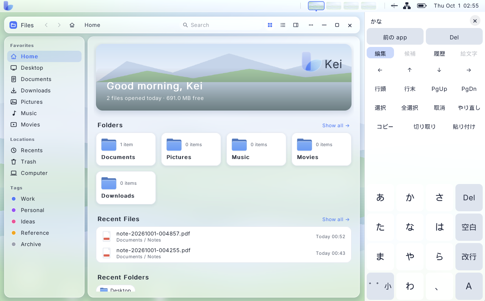

zedBSD and Keiland
==================

It's changing "the way computing is."

---

<div align="center">
  <hr>
  <br>
  <hr>
  <br>
  <hr>
  <br>
  <hr>
</div><br>

---

`zedBSD` is an operating system written from scratch.  It is intended
to run on modern computers, especially on tablets.  `Keiland` is a
next-generation desktop environment especially for power-constrained
computers with touch displays.

---

## Hardware Support

zedBSD and Keiland are already available and are currently being
polished for a production release.

Ourt current targets are the following:

| Vendor                  | Board Name       | CPU Arch    | CPU Model        | GPU Arch       | GPU Model        |
|-------------------------|------------------|-------------|------------------|----------------|------------------|
| StarFive                | Vision Five 2    | RISC-V 64   | StarFive JH7110  | PowerVR        | IMG BXE-4-32 MC1 |
| Raspberry Pi Foundation | Raspberry Pi 5   | Arm64       | Arm Cortex-A76   | VideoCore      | VideoCore VII    |
| Raspberry Pi Foundation | Raspberry Pi 4   | Arm64       | Arm Cortex-A72   | VideoCore      | VideoCore VI     |
| PC                      | Any              | x86_64      | Any              | Any            | Intel/NVIDIA/AMD |

Intel GPU driver is tested on:

| Model          | GPU                    | GPU GEN         |
|----------------|------------------------|-----------------|
| Core i5 7200U  | Intel HD 620           | Gen9.5          |
| Core i5 8265U  | Intel UHD 620          | Gen9.5          |
| Core i5 1135G7 | Intel Iris Xe Graphics | Gen12 Xe-LP TGL |
| Core i5 1235U  | Intel Iris Xe Graphics | Gen12 Xe-LP ADL |

NVIDIA GPU driver is tested on:

| Model            | Architecture      |
|------------------|-------------------|
| GeForce RTX 2070 | Turing            |

AMD GPU driver is tested on:

| Model             | Architecture      |
|-------------------|-------------------|
| Radeon RX 5600 XT | RDNA              |

---

## Written from Scratch

zedBSD consists of a kernel and base system designed to conform to
POSIX.1-2024.  It also ships with `Keiland`, a Wayland-based desktop
environment that unifies the classic mouse UI/UX and a futuristic
touch UI/UX.

The kernel is not derived from existing \*BSD source code.  It has its
own HAL, an advanced portability layer.

Keiland's desktop server is a Wayland compositor that adds many
extensions that existing compositors do not have, so the display,
input, and apps can behave as one machine rather than as a set of
loosely coupled clients.

The GPU stack on zedBSD is also written from scratch.  It has a
native, direct Vulkan path, not Linux DRM/KMS or Mesa.  That said, the
desktop is not locked to this kernel: Keiland is also ported to Linux
and FreeBSD.

The kernel, drivers, libc, and desktop are developed together so that
hardware and software can ship as one product: tablets, phones, and PCs
designed by the same person who directs the OS.

Everything that runs on open hardware stays free to use.  Features
that need the project's own hardware are still published as open
source but run only on that hardware.

## Toward UNIX Certification

zedBSD aims to become a commercial `UNIX` in the line of macOS and
Solaris: an operating system made for newly designed, cutting-edge
computers and changing "the way computing works."  It is written to
conform to `POSIX.1-2024` but is not yet a certified UNIX system.
Conformance will continue to improve, and UNIX certification from `The
Open Group` is a goal.  (`UNIX` is a registered trademark of `The Open
Group`.)

---

## Design

zedBSD adopts a layered architecture.

```
+----------------------------------------+
| Desktop Apps                           |
+----------------------------------------+
| Desktop Server (platform-neutral)      |
+----------------------------------------+
| Desktop HAL (OS-dependent)             |
+----------------------------------------+
| Base programs (/bin)                   |
+----------------------------------------+
| Base services (networkd, audiod, ...)  |
+----------------------------------------+
| Modern init (/sbin/init)               |
+----------------------------------------+
| Drivers                                |
+----------------------------------------+
| Kernel (platform-neutral)              |
+----------------------------------------+
| Kernel HAL (CPU + BSP)                 |
+----------------------------------------+
```

Within this design, a component accesses only components in the layer
directly below it and provides functionality exclusively to the layer
directly above it. Furthermore, dependencies between adjacent layers
are kept strictly one-to-one, preventing tangled cross-layer
interactions.

In the case of Linux desktops, the user environment is typically formed by
numerous components with small, focused responsibilities communicating with one
another. This represents a distributed object design, where the benefit lies in
each component having limited scope, making individual parts relatively easy to
develop. On the other hand, this inevitably creates complex many-to-many
relationships among components. In my view, while systems with
many-to-many relationships are straightforward to implement in isolation, they
often struggle with overall system integration, as seen in
microkernel-based operating systems.

zedBSD adopts a layered architecture to resolve these trade-offs and deliver a
tightly integrated, cohesive desktop experience directly at the OS level.

---

## Keiland Desktop

- The desktop server integrates Wayland, audio, Wi-Fi, Bluetooth, SMS, and image/video media management.
- The compositor supports Touch Mode (single app), Desktop Mode (multiple windows), and Game Mode (direct scanout).
- Users can seamlessly switch between modes via the touch UI/UX.
- The compositor integrates various on-screen keyboards and touch-oriented IMEs.
- A unified UI toolkit is used for both touch and mouse inputs.
- GTK/Qt apps can run via the standard Wayland protocol.

---

## In-kernel Direct Vulkan GPU Drivers

GPU support is a native, direct Vulkan stack.  It does not require
Linux DRM/KMS or Mesa, and it does not use user-space drivers or
compilers.  Our JIT shader compiler is small and simple enough to fit
in the kernel.

Supported GPUs:

| Vendor         | IP                | Confirmed on            | Description      |
|----------------|-------------------|-------------------------|------------------|
| Imagination    | PowerVR           | StarFive Vision Five 2  | Well-optimized   |
| Broadcom       | VideoCore VI      | Raspberry Pi 4          | Well-optimized   |
| Intel          | GEN9 to GEN12     | 6th to 12th Intel Core  | Well-optimized   |
| NVIDIA         | Turing or later   | NVIDIA GeForce RTX 2070 | Modest           |
| AMD            | RDNA or later     | AMD Radeon RX 5600 XT   | Modest           |

---

## Try zedBSD

You do not need to build from source to boot zedBSD.  Pre-built images are
published for real PCs and QEMU.

### PC, Raspberry Pi, and Vision Five 2

Write a disk image to a USB stick or TF card, then boot from it.

Supported hardware:

- x86_64
    - CPU: Intel Core 6th to 14th gen
    - GPU: Intel iGPU, NVIDIA RTX 20+, AMD RDNA+
    - Wi-Fi: Intel AX211, Realtek USB Wi-Fi
    - Bluetooth: USB Bluetooth
    - USB: USB 3.0, USB-C DisplayPort Alt Mode

- Raspberry Pi 4/5
    - GPU, USB, Wi-Fi, and Ethernet are supported
    - The onboard Bluetooth driver is still being debugged and will be merged soon

- Vision Five 2
    - GPU, USB, Ethernet

---

## Keiland Desktop on Linux

```sh
git clone https://github.com/awemorris/zedBSD.git
cd zedBSD
make keiland-linux
make keiland-linux-install
```

`make keiland-linux` first checks with the package manager (apt, dnf/yum, or
pacman) that the packages the build needs are installed. When some are missing,
it lists them and, on a terminal, offers to install them with sudo; otherwise it
prints the command and stops. After a successful build, it offers to install
Keiland immediately, which makes `make keiland-linux-install` unnecessary. With
`KEILAND_ASK=n`, it asks nothing and only prints. The package names are in
[userland/desktop/LINUX.md](userland/desktop/LINUX.md).

Then restart your display manager (e.g., GDM).

To run Keiland manually, type:

```sh
/opt/keiland/bin/keiland-desktop
```

---

## Keiland Desktop on FreeBSD

```sh
git clone https://github.com/awemorris/zedBSD.git
cd zedBSD
make keiland-freebsd
make keiland-freebsd-install
```

As on Linux, `make keiland-freebsd` checks the needed packages with `pkg`,
offers to install the missing ones, and offers to install Keiland after a successful build
([userland/desktop/README.freebsd.md](userland/desktop/README.freebsd.md)).

To run Keiland manually, type:

```sh
/opt/keiland/bin/keiland-desktop
```

---

## Open Hardware and Project Hardware

Code that runs on commercially available hardware (PCs, Raspberry Pi
series, and other SBCs) is free for anyone to build and use.  That
includes commercial use, modification, and redistribution under the
[zlib License](LICENSE).  Buying project hardware is not required to
use that part of the system, and that split is meant to stay.

Some features can only be realized on hardware designed by this
project.  Those features are still published as source, under the same
license.  They are not a closed edition.  They depend on that
hardware, so they do not run on a generic PC or Raspberry Pi.  The
sold product is the computer, not a paid OS license.

zedBSD stays under zlib as its long-term license.  Improvements to the
open-hardware system stay freely usable.

Our hardware projects:
- [Amaterrace GPU](https://github.com/awemorris/amaterrace-gpu)
- [Sukuna RISC](https://github.com/awemorris/sukuna-risc)

My goal is to provide $50 tablets and $30 SBCs to resource-limited
areas to help achieve things like more efficient food production and
lower transportation costs through autonomous driving.

Of course, I'd love to provide the kind of high-end laptops that geeks
swear by as well!

---

## Why a New Stack?

Two objections often come up: why not use the existing open-source
operating-system ecosystem, and isn't a Wayland compositor written here merely
freeloading on that work?

The first reason is the license of the operating system itself. A distribution
assembled from the usual kernel, libc, desktop, and applications carries a large
set of licenses. Tracking that set is a core job of a project such as Debian. By
contrast, zedBSD, the base userland, the libraries, Keiland, and the
applications written for this system are all under the zlib License, giving the
operating system a single license. Optional third-party packages under `/usr`
can still carry their own licenses; they are not part of that single-license
base.

The second reason is who can change the stack. On Linux, the kernel, libc,
desktop, and applications are developed by separate organizations. A change that
spans all of those layers is slow, and sometimes impossible, to land as one
piece of work. Here, those layers are under unified direction. A workload can be
tuned by changing the kernel, the library, the compositor, and the application
together.

Keiland implements the Wayland specification and adds extensions that existing
compositors do not have. The specification is merely the interface. The
compositor, its extensions, and the clients are written specifically for this
system so the display stack can evolve with the rest of the OS. That is a
reimplementation, not a repackaging of an existing compositor.

The new kernel is not a wall. Keiland has been ported so the desktop also runs
on Linux and FreeBSD. The work is published under the zlib License for that very
purpose: take it, ship it, and build on it. The point of this open-hardware
system is open innovation, not a requirement that every user boot zedBSD.

Furthermore, Keiland effectively acts as a secondary OS, much like OPENSTEP
did. The Keiland desktop server features original Wayland extensions that
integrate audio access, Wi-Fi/LAN and Bluetooth settings, a picture/video media
library, calls and SMS via Bluetooth-connected smartphones or modems, an
on-screen keyboard, predictive conversion for IMEs, user account management, and
FIDO2 security. Because all of these are implemented within the Keiland backend,
Keiland can be ported to any OS simply by implementing an OS backend. Moreover,
since Keiland applications depend only on `libkeiland`, they can even be ported
to Windows using `libkeiland.dll`.

Although the Keiland desktop server uses the Wayland protocol as its front-end
API and Vulkan WSI for its backend, it is actually a "desktop OS server" and a
"desktop app toolkit" rather than just a Wayland compositor. This is much like
how Windows and macOS work, and it is something Linux lacks.

---

## What You Get

- **zedBSD** — kernel, HAL, drivers, libc, and base userland.

- **Keiland** — Wayland compositor and client applications for
    touch. Extensions beyond existing compositors are added so input,
    display, and applications work as one system. The desktop also
    runs on Linux and FreeBSD.

- **Native Vulkan** — a GPU stack that does not sit on Linux DRM/KMS
    or Mesa, and does not use user-space drivers.

- **Kei** — the zedBSD-based operating system image.

---

## Building

Host prerequisites, configuration, image layout, and the QEMU procedure are in
the build-from-source guide.

On amd64, the default disk image uses the native layout: a GPT disk whose ESP
holds the UEFI loader and the kernel, a read-write UFS root partition, and a
swap partition. `make run` starts QEMU with OVMF and an NVMe disk. Hybrid (UEFI and
BIOS), UEFI-only, and BIOS-only layouts are chosen by setting `ZEDBSD_VARIANT`
(`hybrid`, `uefi`, `bios`) in `config.mk`; `make menuconfig` keeps the value it
reads.

```sh
make                   # same as disk-image
make menuconfig        # write config.mk
make disk-image        # build a disk image
make world             # build vmunix and rootfs
make rootfs            # build rootfs
make vmunix            # build the vmunix kernel
make run               # build a disk image and start QEMU
make toolchain-cache   # install the pinned rev-0 LLVM cache (x86_64 Linux)
make toolchain         # build a toolchain
make help              # short command summary
```

---

## Tree

| Directory            | Description                                      |
|----------------------|--------------------------------------------------|
| `include/`           | Public HAL, kernel, and user ABI interfaces      |
| `src/hal/`           | Architecture HALs and board support              |
| `src/kern/`          | Platform-neutral kernel                          |
| `src/drivers/`       | Device and bus drivers                           |
| `src/libc/`          | zedBSD libc                                      |
| `userland/`          | Userland programs                                |
| `userland/base/`     | Base programs and libraries (`/bin`, `/lib`)     |
| `userland/comp/`     | Compilers                                        |
| `userland/desktop/`  | Keiland programs                                 |
| `userland/firmware/` | Optional per-device firmware packages            |
| `userland/packages/` | Third-party packages (`/usr`)                    |
| `platform/`          | Target Makefiles and tools                       |
| `vendor/`            | External programs                                |
| `tools/`             | Development scripts                              |
| `tests/`             | Tests                                            |

---

## Cost Breakdown

The following is our initial cost estimate:

| Item                                  | Initial Cost       | Per-unit Royalty @100 | Per-unit Royalty @1000 | Per-unit Royalty @10000 |
|---------------------------------------|--------------------|-----------------------|------------------------|-------------------------|
| UNIX® Certification (The Open Group) | $13,300 (50% off?) | $0                    | $0                     | $0                      |
| H.264 (Via LA)                        | $0                 | $0                    | $0                     | $0                      |
| AAC                                   | $0                 | $1                    | $1                     | $1                      |
| Bluetooth (Bluetooth SIG)             | $30,000            | $0                    | $0                     | $0                      |
| Commercial Fonts                      | $5,000             | $10                   | $10                    | $10                     |
| Crypto Export Administration          | $3,300             | $0                    | $0                     | $0                      |

So, the total initial cost is around $45,000.
(The UNIX certification is 50% off, based on our software volume tier.)

Estimated price per copy by lot size:

| Lot                | Price per copy | 
|--------------------|----------------|
| Starting at 1000   | $56            |
| Starting at 10000  | $16            |
| Starting at 100000 | $12            |

Even without the UNIX and Bluetooth licenses, the price at 10,000
units wouldn't change much.

| Lot                | Price per copy |
|--------------------|----------------|
| Starting at 1000   | $25            |
| Starting at 10000  | $13            |
| Starting at 100000 | $12            |

Targeting an initial release of **10,000 copies** puts our effective
cost at around $16, allowing a retail price of **$20–$30 per copy**,
which is highly competitive and reasonable.

**Conclusion:**
To cover the initial costs, I would need to fund this project through crowdfunding by securing either:
- **~10,000 backers at $5 each**, or
- **~1,000 backers at $50 each**.

---

## Web Browser

zedBSD's libbrowser is being developed against WPT (Web Platform Tests), with
the behavior of Chrome's V8 and Blink engines serving as the test oracle.  AI
agents are run in a loop until the tests reach a 95% pass rate.

---

## AI Usage

Both zedBSD and Keiland Desktop are [architected and
directed](plan/master.md) by a solo developer and implemented via AI
coding agents.

Please note that the author is an enterprise systems architect who
typically directs teams rather than writing code manually.  The same
architectural leadership is applied to AI agents, so this project is
systematically engineered.  Please do not call it "vibe-coded."

Debugging is powered by an advanced Vision-Language Model loop that
monitors the target screen via a camera, alongside serial and SSH
console output.  In addition, the board's power is routed through a
SwitchBot smart plug, allowing the AI to autonomously reboot the
device via API after deploying a new kernel over SCP.

This project is not a clone of any existing OS.  Every layer,
including the desktop, is engineered from the ground up.

---

## License

zedBSD and Keiland Desktop are distributed under the zlib License. See
[LICENSE](LICENSE). The license is not a placeholder for a later proprietary
release. The system is meant to stay published under zlib, including features
that run only on project hardware. What runs on open hardware PCs, Raspberry Pi,
and the other public targets stays free for anyone to use while conformance
work, including a future UNIX certification, continues.
